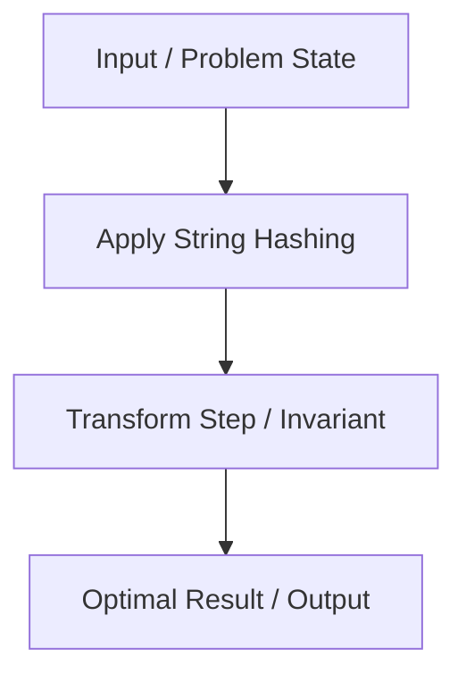

# String Hashing

> **Category:** Strings · **Tier:** Core Interview (High-Yield)

---

## 🔗 Resources & Visualizers
- **YouTube:** [Watch String Hashing Visual Guide](https://www.youtube.com/results?search_query=String%20Hashing%20algorithm%20visual%20explanation)
- **Blog / Editorial:** [CP-Algorithms / GeeksforGeeks Guide](https://www.google.com/search?q=String%20Hashing%20algorithm%20tutorial%20CP%20algorithms)
- **Interactive Visualizer:** [VisuAlgo Interactive Simulation](https://visualgo.net/en)

---

## 🧠 Intuition & Mental Model
> [!TIP]
> **Core Concept:** String Hashing converts a string into a numeric value using a mathematical

String Hashing converts a string into a numeric value using a mathematical
formula so that string comparisons can be done efficiently.
It is mainly used to compare substrings in O(1) time after preprocessing.
Algorithm Explanation
Each character is mapped to a number ('a' → 1, 'b' → 2, …).
A base p (usually a prime like 31) is chosen.
The hash of a string is computed as:
s[0]*p^0 + s[1]*p^1 + s[2]*p^2 + ...
Prefix hashes are stored so substring hashes can be computed quickly.
Two substrings are equal if their hashes are equal (with very high probability).
(Simple example: compute hash of string "abc")

---

## 🎯 When to Use & Problem Triggers
- **Trigger 1:** When the brute-force enumeration takes quadratic time or higher and a linear/logarithmic invariant exists.
- **Trigger 2:** Common patterns involving **Strings**, subsegments, query sequences, or optimal substructures.
- **Trigger 3:** Constraints where $N \ge 10^5$ require $O(N)$ or $O(N \log N)$ performance.

---

## 📊 Visual Explanation & Dry Run



<details>
<summary>🔍 <strong>Step-by-Step Algorithm Walkthrough</strong> (Click to expand)</summary>

1. **Initialization:** Set up boundary pointers, state variables, or base auxiliary arrays.
2. **Iteration / Traversal:** Advance through the input elements while maintaining the algorithmic invariant.
3. **State Transition:** Update the current state, dynamic array, or accumulator in $O(1)$ or $O(\log N)$.
4. **Final Result:** Extract the optimal answer from the computed state or reconstructed solution.

</details>

---

## 💻 Algorithm Code (Java)

```java
import java.io.*;

class Main {
    public static void main(String[] args) throws Exception {
        BufferedReader br = new BufferedReader(new InputStreamReader(System.in));
        PrintWriter out = new PrintWriter(System.out);

        String s = "abc";
        int n = s.length();

        long p = 31;
        long mod = 1000000007;

        long hash = 0;
        long power = 1;

        for (int i = 0; i < n; i++) {
            int val = s.charAt(i) - 'a' + 1;
            hash = (hash + val * power) % mod;
            power = (power * p) % mod;
        }

        out.println("Hash of String \"" + s + "\" = " + hash);
        out.flush();
    }
}
```

---

## ⏱️ Complexity Analysis
- **Time Complexity (TC):** Typically `O(N)` or `O(N log N)` depending on auxiliary sorting or tree operations.
- **Space Complexity (SC):** Typically `O(1)` auxiliary space or `O(N)` for auxiliary arrays/tables.

---

## 🔄 Similar & Connected Algorithms
- **Related Category:** Explore other fundamental algorithms in [Strings](../).
- **Composite Patterns:** Often combined with Prefix Sums, Binary Search on Answer, or Dynamic Programming memoization.

---

## ⚔️ Practice Questions

### 🟡 LeetCode
- [ ] [Explore String Hashing Problems on LeetCode](https://leetcode.com/problemset/?search=String%20Hashing%20LeetCode) — `Practice`

### 🔵 CodeChef & Codeforces
- [ ] [Practice on Codeforces Problemset](https://codeforces.com/problemset) — `Catalog`
- [ ] [Practice on CodeChef Practice Portal](https://www.codechef.com/practice) — `Catalog`
