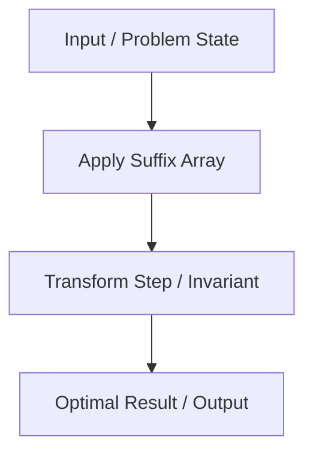

# Suffix Array

> **Category:** Strings · **Tier:** Advanced Interview (Strings)

---

## 🔗 Resources & Visualizers
- **YouTube:** [Watch Suffix Array Visual Guide](https://www.youtube.com/results?search_query=Suffix%20Array%20algorithm%20visual%20explanation)
- **Blog / Editorial:** [CP-Algorithms / GeeksforGeeks Guide](https://www.google.com/search?q=Suffix%20Array%20algorithm%20tutorial%20CP%20algorithms)
- **Interactive Visualizer:** [VisuAlgo Interactive Simulation](https://visualgo.net/en)

---

## 🧠 Intuition & Mental Model
> [!TIP]
> **Core Concept:** A Suffix Array is an array of indices representing all suffixes of a

A Suffix Array is an array of indices representing all suffixes of a
string sorted in lexicographical order.
It enables fast string operations like pattern matching and
longest common prefix queries.
Algorithm Explanation :
Generate all suffixes of the string.
Store each suffix along with its starting index.
Sort suffixes lexicographically.
Extract only the starting indices → this is the Suffix Array.
Optimized versions avoid storing full strings and use ranking (doubling technique).

---

## 🎯 When to Use & Problem Triggers
- **Trigger 1:** When the brute-force enumeration takes quadratic time or higher and a linear/logarithmic invariant exists.
- **Trigger 2:** Common patterns involving **Strings**, subsegments, query sequences, or optimal substructures.
- **Trigger 3:** Constraints where $N \ge 10^5$ require $O(N)$ or $O(N \log N)$ performance.

---

## 📊 Visual Explanation & Dry Run



<details>
<summary>🔍 <strong>Step-by-Step Algorithm Walkthrough</strong> (Click to expand)</summary>

1. **Initialization:** Set up boundary pointers, state variables, or base auxiliary arrays.
2. **Iteration / Traversal:** Advance through the input elements while maintaining the algorithmic invariant.
3. **State Transition:** Update the current state, dynamic array, or accumulator in $O(1)$ or $O(\log N)$.
4. **Final Result:** Extract the optimal answer from the computed state or reconstructed solution.

</details>

---

## 💻 Algorithm Code (Java)

```java
import java.io.*;
import java.util.*;

class Main {

    static class Suffix {
        int index;
        int rank;
        int nextRank;
    }

    public static void main(String[] args) throws Exception {
        String s = "banana";
        int n = s.length();

        Suffix[] suf = new Suffix[n];

        for (int i = 0; i < n; i++) {
            suf[i] = new Suffix();
            suf[i].index = i;
            suf[i].rank = s.charAt(i) - 'a';
            suf[i].nextRank = (i + 1 < n) ? s.charAt(i + 1) - 'a' : -1;
        }

        Arrays.sort(suf, (a, b) -> {
            if (a.rank != b.rank) return a.rank - b.rank;
            return a.nextRank - b.nextRank;
        });

        int[] ind = new int[n];

        for (int k = 4; k < 2 * n; k *= 2) {
            int rank = 0;
            int prevRank = suf[0].rank;
            suf[0].rank = rank;
            ind[suf[0].index] = 0;

            for (int i = 1; i < n; i++) {
                if (suf[i].rank == prevRank && suf[i].nextRank == suf[i - 1].nextRank) {
                    suf[i].rank = rank;
                } else {
                    prevRank = suf[i].rank;
                    suf[i].rank = ++rank;
                }

                ind[suf[i].index] = i;
            }

            for (int i = 0; i < n; i++) {
                int nextIndex = suf[i].index + k / 2;
                suf[i].nextRank = (nextIndex < n) ? suf[ind[nextIndex]].rank : -1;
            }

            Arrays.sort(suf, (a, b) -> {
                if (a.rank != b.rank) return a.rank - b.rank;
                return a.nextRank - b.nextRank;
            });
        }

        int[] suffixArray = new int[n];
        for (int i = 0; i < n; i++) {
            suffixArray[i] = suf[i].index;
        }

        System.out.println("Suffix Array:");
        for (int x : suffixArray) {
            System.out.print(x + " ");
        }
    }
}
```

---

## ⏱️ Complexity Analysis
- **Time Complexity (TC):** Typically `O(N)` or `O(N log N)` depending on auxiliary sorting or tree operations.
- **Space Complexity (SC):** Typically `O(1)` auxiliary space or `O(N)` for auxiliary arrays/tables.

---

## 🔄 Similar & Connected Algorithms
- **Related Category:** Explore other fundamental algorithms in [Strings](../).
- **Composite Patterns:** Often combined with Prefix Sums, Binary Search on Answer, or Dynamic Programming memoization.

---

## ⚔️ Practice Questions

### 🟡 LeetCode
- [ ] [Explore Suffix Array Problems on LeetCode](https://leetcode.com/problemset/?search=Suffix%20Array%20LeetCode) — `Practice`

### 🔵 CodeChef & Codeforces
- [ ] [Practice on Codeforces Problemset](https://codeforces.com/problemset) — `Catalog`
- [ ] [Practice on CodeChef Practice Portal](https://www.codechef.com/practice) — `Catalog`
