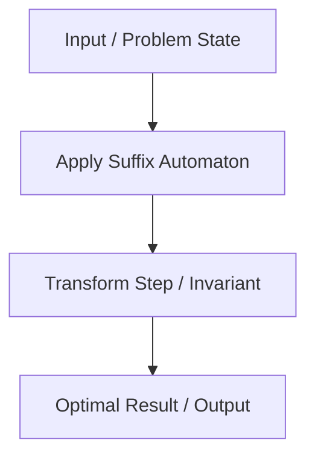

# Suffix Automaton

> **Category:** Strings · **Tier:** Competitive Programming (Strings)

---

## 🔗 Resources & Visualizers
- **YouTube:** [Watch Suffix Automaton Visual Guide](https://www.youtube.com/results?search_query=Suffix%20Automaton%20algorithm%20visual%20explanation)
- **Blog / Editorial:** [CP-Algorithms / GeeksforGeeks Guide](https://www.google.com/search?q=Suffix%20Automaton%20algorithm%20tutorial%20CP%20algorithms)
- **Interactive Visualizer:** [VisuAlgo Interactive Simulation](https://visualgo.net/en)

---

## 🧠 Intuition & Mental Model
> [!TIP]
> **Core Concept:** Suffix Automaton (SAM) is a compressed automaton that

Suffix Automaton (SAM) is a compressed automaton that
represents all substrings of a string.
It allows substring queries in linear time construction.
How the Algorithm Works :
Build the automaton character by character
Each state represents a set of substrings with:
len → length of longest substring in that state
link → suffix link (like fallback)
next[] → transitions by characters
While adding a new character:
Create a new state for extended substrings
Update transitions backward using suffix links
If conflict occurs, create a clone state to preserve correctness
End result compactly stores all substrings

---

## 🎯 When to Use & Problem Triggers
- **Trigger 1:** When the brute-force enumeration takes quadratic time or higher and a linear/logarithmic invariant exists.
- **Trigger 2:** Common patterns involving **Strings**, subsegments, query sequences, or optimal substructures.
- **Trigger 3:** Constraints where $N \ge 10^5$ require $O(N)$ or $O(N \log N)$ performance.

---

## 📊 Visual Explanation & Dry Run



<details>
<summary>🔍 <strong>Step-by-Step Algorithm Walkthrough</strong> (Click to expand)</summary>

1. **Initialization:** Set up boundary pointers, state variables, or base auxiliary arrays.
2. **Iteration / Traversal:** Advance through the input elements while maintaining the algorithmic invariant.
3. **State Transition:** Update the current state, dynamic array, or accumulator in $O(1)$ or $O(\log N)$.
4. **Final Result:** Extract the optimal answer from the computed state or reconstructed solution.

</details>

---

## 💻 Algorithm Code (Java)

```java
import java.io.*;
import java.util.*;

class Main {

    static class State {
        int len;
        int link;
        int[] next = new int[26];

        State() {
            Arrays.fill(next, -1);
        }
    }

    static State[] st;
    static int sz;
    static int last;

    static void saInit() {
        st = new State[100];
        st[0] = new State();
        st[0].len = 0;
        st[0].link = -1;
        sz = 1;
        last = 0;
    }

    static void saExtend(char c) {
        int cur = sz++;
        st[cur] = new State();
        st[cur].len = st[last].len + 1;

        int p = last;
        int x = c - 'a';

        while (p != -1 && st[p].next[x] == -1) {
            st[p].next[x] = cur;
            p = st[p].link;
        }

        if (p == -1) {
            st[cur].link = 0;
        } else {
            int q = st[p].next[x];
            if (st[p].len + 1 == st[q].len) {
                st[cur].link = q;
            } else {
                int clone = sz++;
                st[clone] = new State();
                st[clone].len = st[p].len + 1;
                st[clone].next = st[q].next.clone();
                st[clone].link = st[q].link;

                while (p != -1 && st[p].next[x] == q) {
                    st[p].next[x] = clone;
                    p = st[p].link;
                }

                st[q].link = st[cur].link = clone;
            }
        }

        last = cur;
    }

    public static void main(String[] args) throws Exception {
        BufferedReader br = new BufferedReader(new InputStreamReader(System.in));
        PrintWriter out = new PrintWriter(System.out);

        String s = "aba";
        saInit();

        for (int i = 0; i < s.length(); i++) {
            saExtend(s.charAt(i));
        }

        out.println("States Count: " + sz);
        out.println("Each state represents substrings of \"aba\"");

        out.flush();
    }
}
```

---

## ⏱️ Complexity Analysis
- **Time Complexity (TC):** Typically `O(N)` or `O(N log N)` depending on auxiliary sorting or tree operations.
- **Space Complexity (SC):** Typically `O(1)` auxiliary space or `O(N)` for auxiliary arrays/tables.

---

## 🔄 Similar & Connected Algorithms
- **Related Category:** Explore other fundamental algorithms in [Strings](../).
- **Composite Patterns:** Often combined with Prefix Sums, Binary Search on Answer, or Dynamic Programming memoization.

---

## ⚔️ Practice Questions

### 🟡 LeetCode
- [ ] [Explore Suffix Automaton Problems on LeetCode](https://leetcode.com/problemset/?search=Suffix%20Automaton%20LeetCode) — `Practice`

### 🔵 CodeChef & Codeforces
- [ ] [Practice on Codeforces Problemset](https://codeforces.com/problemset) — `Catalog`
- [ ] [Practice on CodeChef Practice Portal](https://www.codechef.com/practice) — `Catalog`
