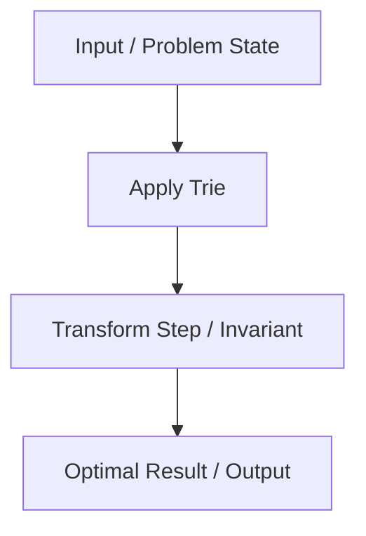

# Trie

> **Category:** Strings · **Tier:** Core Interview (Essential)

---

## 🔗 Resources & Visualizers
- **YouTube:** [Watch Trie Visual Guide](https://www.youtube.com/results?search_query=Trie%20algorithm%20visual%20explanation)
- **Blog / Editorial:** [CP-Algorithms / GeeksforGeeks Guide](https://www.google.com/search?q=Trie%20algorithm%20tutorial%20CP%20algorithms)
- **Interactive Visualizer:** [VisuAlgo Interactive Simulation](https://visualgo.net/en)

---

## 🧠 Intuition & Mental Model
> [!TIP]
> **Core Concept:** A Trie is a tree-based data structure used to store strings where

A Trie is a tree-based data structure used to store strings where
each node represents a character.
It enables fast prefix-based search and insertion.
How Trie Algorithm Works :
Start from a root node (empty character).
Each edge represents one character.
Insert word character by character.
If a character node doesn’t exist → create it.
Mark the last character of a word as end-of-word.
For search, traverse characters sequentially.
If traversal breaks → word does not exist.
If traversal ends and end-of-word is true → word exists.
example: insert "cat" and "car", then search "cat"

---

## 🎯 When to Use & Problem Triggers
- **Trigger 1:** When the brute-force enumeration takes quadratic time or higher and a linear/logarithmic invariant exists.
- **Trigger 2:** Common patterns involving **Strings**, subsegments, query sequences, or optimal substructures.
- **Trigger 3:** Constraints where $N \ge 10^5$ require $O(N)$ or $O(N \log N)$ performance.

---

## 📊 Visual Explanation & Dry Run



<details>
<summary>🔍 <strong>Step-by-Step Algorithm Walkthrough</strong> (Click to expand)</summary>

1. **Initialization:** Set up boundary pointers, state variables, or base auxiliary arrays.
2. **Iteration / Traversal:** Advance through the input elements while maintaining the algorithmic invariant.
3. **State Transition:** Update the current state, dynamic array, or accumulator in $O(1)$ or $O(\log N)$.
4. **Final Result:** Extract the optimal answer from the computed state or reconstructed solution.

</details>

---

## 💻 Algorithm Code (Java)

```java
import java.io.*;
import java.util.*;

class TrieExample {

    static class TrieNode {
        TrieNode[] child;
        boolean isEnd;

        TrieNode() {
            child = new TrieNode[26];
            isEnd = false;
        }
    }

    static TrieNode root = new TrieNode();

    static void insert(String word) {
        TrieNode cur = root;

        for (int i = 0; i < word.length(); i++) {
            int idx = word.charAt(i) - 'a';

            if (cur.child[idx] == null) {
                cur.child[idx] = new TrieNode();
            }

            cur = cur.child[idx];
        }

        cur.isEnd = true;
    }

    static boolean search(String word) {
        TrieNode cur = root;

        for (int i = 0; i < word.length(); i++) {
            int idx = word.charAt(i) - 'a';

            if (cur.child[idx] == null) {
                return false;
            }

            cur = cur.child[idx];
        }

        return cur.isEnd;
    }

    public static void main(String[] args) throws Exception {
        PrintWriter out = new PrintWriter(System.out);

        insert("cat");
        insert("car");

        out.println(search("cat"));
        out.println(search("cap"));

        out.flush();
    }
}
```

---

## ⏱️ Complexity Analysis
- **Time Complexity (TC):** Typically `O(N)` or `O(N log N)` depending on auxiliary sorting or tree operations.
- **Space Complexity (SC):** Typically `O(1)` auxiliary space or `O(N)` for auxiliary arrays/tables.

---

## 🔄 Similar & Connected Algorithms
- **Related Category:** Explore other fundamental algorithms in [Strings](../).
- **Composite Patterns:** Often combined with Prefix Sums, Binary Search on Answer, or Dynamic Programming memoization.

---

## ⚔️ Practice Questions

### 🟡 LeetCode
- [ ] [208. Implement Trie (Prefix Tree)](https://leetcode.com/problems/implement-trie-prefix-tree/) — `Medium`
- [ ] [211. Design Add and Search Words Data Structure](https://leetcode.com/problems/design-add-and-search-words-data-structure/) — `Medium`
- [ ] [212. Word Search II](https://leetcode.com/problems/word-search-ii/) — `Hard`

### 🔵 CodeChef & Codeforces
- [ ] [706D - Vasiliy's Multiset](https://codeforces.com/problemset/problem/706/D) — `1800`
