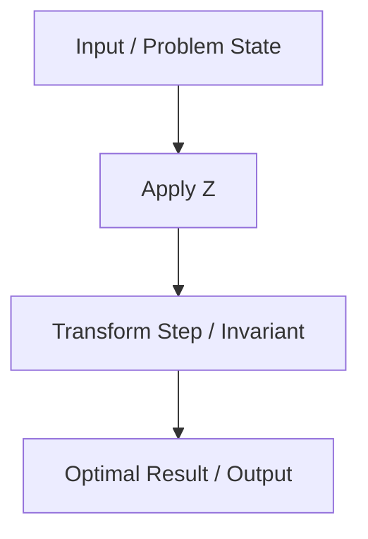

# Z

> **Category:** Strings · **Tier:** Advanced Interview (Strings)

---

## 🔗 Resources & Visualizers
- **YouTube:** [Watch Z Visual Guide](https://www.youtube.com/results?search_query=Z%20algorithm%20visual%20explanation)
- **Blog / Editorial:** [CP-Algorithms / GeeksforGeeks Guide](https://www.google.com/search?q=Z%20algorithm%20tutorial%20CP%20algorithms)
- **Interactive Visualizer:** [VisuAlgo Interactive Simulation](https://visualgo.net/en)

---

## 🧠 Intuition & Mental Model
> [!TIP]
> **Core Concept:** Z-Algorithm computes an array where each index stores the length of the

Z-Algorithm computes an array where each index stores the length of the
longest substring starting from that index which matches the prefix of the string.
It helps in pattern matching and string analysis efficiently.
How the Algorithm Works :
Create an array Z[] where Z[i] = length of match between s[0…] and s[i…]
Maintain a window [L, R] where substring matches the prefix
If i > R → start matching from scratch
If i ≤ R → reuse previously computed Z values
Extend matches only when necessary
This avoids repeated comparisons

---

## 🎯 When to Use & Problem Triggers
- **Trigger 1:** When the brute-force enumeration takes quadratic time or higher and a linear/logarithmic invariant exists.
- **Trigger 2:** Common patterns involving **Strings**, subsegments, query sequences, or optimal substructures.
- **Trigger 3:** Constraints where $N \ge 10^5$ require $O(N)$ or $O(N \log N)$ performance.

---

## 📊 Visual Explanation & Dry Run



<details>
<summary>🔍 <strong>Step-by-Step Algorithm Walkthrough</strong> (Click to expand)</summary>

1. **Initialization:** Set up boundary pointers, state variables, or base auxiliary arrays.
2. **Iteration / Traversal:** Advance through the input elements while maintaining the algorithmic invariant.
3. **State Transition:** Update the current state, dynamic array, or accumulator in $O(1)$ or $O(\log N)$.
4. **Final Result:** Extract the optimal answer from the computed state or reconstructed solution.

</details>

---

## 💻 Algorithm Code (Java)

```java
import java.io.*;

class ZAlgorithm {
    public static void main(String[] args) {
        String s = "aaabxaab";
        int n = s.length();

        int[] z = new int[n];
        int l = 0, r = 0;

        for (int i = 1; i < n; i++) {
            if (i > r) {
                l = r = i;
                while (r < n && s.charAt(r) == s.charAt(r - l)) {
                    r++;
                }
                z[i] = r - l;
                r--;
            } else {
                int k = i - l;

                if (z[k] < r - i + 1) {
                    z[i] = z[k];
                } else {
                    l = i;
                    while (r < n && s.charAt(r) == s.charAt(r - l)) {
                        r++;
                    }

                    z[i] = r - l;
                    r--;
                }
            }
        }

        for (int i = 0; i < n; i++) {
            System.out.print(z[i] + " ");
        }
    }
}
```

---

## ⏱️ Complexity Analysis
- **Time Complexity (TC):** Typically `O(N)` or `O(N log N)` depending on auxiliary sorting or tree operations.
- **Space Complexity (SC):** Typically `O(1)` auxiliary space or `O(N)` for auxiliary arrays/tables.

---

## 🔄 Similar & Connected Algorithms
- **Related Category:** Explore other fundamental algorithms in [Strings](../).
- **Composite Patterns:** Often combined with Prefix Sums, Binary Search on Answer, or Dynamic Programming memoization.

---

## ⚔️ Practice Questions

### 🟡 LeetCode
- [ ] [Explore Z Problems on LeetCode](https://leetcode.com/problemset/?search=Z%20LeetCode) — `Practice`

### 🔵 CodeChef & Codeforces
- [ ] [Practice on Codeforces Problemset](https://codeforces.com/problemset) — `Catalog`
- [ ] [Practice on CodeChef Practice Portal](https://www.codechef.com/practice) — `Catalog`
