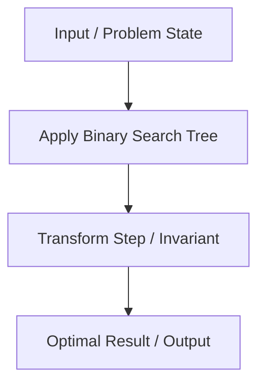

# Binary Search Tree

> **Category:** Trees · **Tier:** Core Interview (Essential)

---

## 🔗 Resources & Visualizers
- **YouTube:** [Watch Binary Search Tree Visual Guide](https://www.youtube.com/results?search_query=Binary%20Search%20Tree%20algorithm%20visual%20explanation)
- **Blog / Editorial:** [CP-Algorithms / GeeksforGeeks Guide](https://www.google.com/search?q=Binary%20Search%20Tree%20algorithm%20tutorial%20CP%20algorithms)
- **Interactive Visualizer:** [VisuAlgo Interactive Simulation](https://visualgo.net/en)

---

## 🧠 Intuition & Mental Model
> [!TIP]
> **Core Concept:** A Binary Search Tree (BST) is a binary tree where for every node:

A Binary Search Tree (BST) is a binary tree where for every node:
left subtree values < node and right subtree values > node.
How the BST Algorithm Works
Start with an empty tree
Insert the first value as the root
For every new value:
If value < current node, move left
If value > current node, move right
Repeat until a null position is found
Insert the node there
This ordering enables fast search, insert, and delete

---

## 🎯 When to Use & Problem Triggers
- **Trigger 1:** When the brute-force enumeration takes quadratic time or higher and a linear/logarithmic invariant exists.
- **Trigger 2:** Common patterns involving **Trees**, subsegments, query sequences, or optimal substructures.
- **Trigger 3:** Constraints where $N \ge 10^5$ require $O(N)$ or $O(N \log N)$ performance.

---

## 📊 Visual Explanation & Dry Run



<details>
<summary>🔍 <strong>Step-by-Step Algorithm Walkthrough</strong> (Click to expand)</summary>

1. **Initialization:** Set up boundary pointers, state variables, or base auxiliary arrays.
2. **Iteration / Traversal:** Advance through the input elements while maintaining the algorithmic invariant.
3. **State Transition:** Update the current state, dynamic array, or accumulator in $O(1)$ or $O(\log N)$.
4. **Final Result:** Extract the optimal answer from the computed state or reconstructed solution.

</details>

---

## 💻 Algorithm Code (Java)

```java
import java.io.*;
import java.util.*;

class Main {

    static class Node {
        int val;
        Node left, right;

        Node(int v) {
            val = v;
            left = right = null;
        }
    }

    static Node insert(Node root, int v) {
        if (root == null) {
            return new Node(v);
        }

        if (v < root.val) {
            root.left = insert(root.left, v);
        } else if (v > root.val) {
            root.right = insert(root.right, v);
        }

        return root;
    }

    static void inorder(Node root) {
        if (root == null) return;

        inorder(root.left);
        System.out.print(root.val + " ");
        inorder(root.right);
    }

    public static void main(String[] args) {
        Node root = null;

        int[] a = {5, 3, 7, 2, 4};

        for (int x : a) {
            root = insert(root, x);
        }

        inorder(root);
    }
}
```

---

## ⏱️ Complexity Analysis
- **Time Complexity (TC):** Typically `O(N)` or `O(N log N)` depending on auxiliary sorting or tree operations.
- **Space Complexity (SC):** Typically `O(1)` auxiliary space or `O(N)` for auxiliary arrays/tables.

---

## 🔄 Similar & Connected Algorithms
- **Related Category:** Explore other fundamental algorithms in [Trees](../).
- **Composite Patterns:** Often combined with Prefix Sums, Binary Search on Answer, or Dynamic Programming memoization.

---

## ⚔️ Practice Questions

### 🟡 LeetCode
- [ ] [Explore Binary Search Tree Problems on LeetCode](https://leetcode.com/problemset/?search=Binary%20Search%20Tree%20LeetCode) — `Practice`

### 🔵 CodeChef & Codeforces
- [ ] [Practice on Codeforces Problemset](https://codeforces.com/problemset) — `Catalog`
- [ ] [Practice on CodeChef Practice Portal](https://www.codechef.com/practice) — `Catalog`
