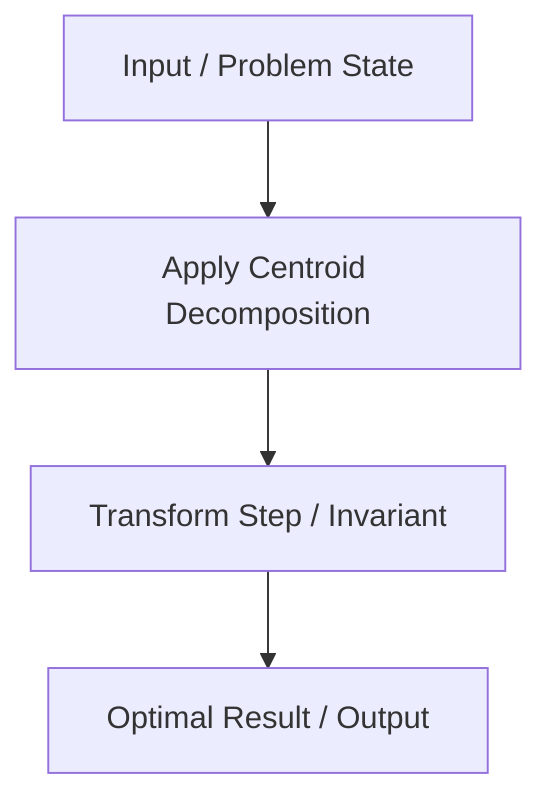

# Centroid Decomposition

> **Category:** Trees · **Tier:** Competitive Programming (Tree Divide & Conquer)

---

## 🔗 Resources & Visualizers
- **YouTube:** [Watch Centroid Decomposition Visual Guide](https://www.youtube.com/results?search_query=Centroid%20Decomposition%20algorithm%20visual%20explanation)
- **Blog / Editorial:** [CP-Algorithms / GeeksforGeeks Guide](https://www.google.com/search?q=Centroid%20Decomposition%20algorithm%20tutorial%20CP%20algorithms)
- **Interactive Visualizer:** [VisuAlgo Interactive Simulation](https://visualgo.net/en)

---

## 🧠 Intuition & Mental Model
> [!TIP]
> **Core Concept:** Centroid Decomposition is a divide-and-conquer technique on

Centroid Decomposition is a divide-and-conquer technique on
trees where we repeatedly remove a centroid node so that all resulting
subtrees have size ≤ N/2.
This converts a tree problem into smaller independent subproblems.
Algorithm Explanation
A centroid of a tree is a node whose removal splits the tree
into subtrees of size at most half.
Step 1: Compute subtree sizes using DFS.
Step 2: Find the centroid using subtree sizes.
Step 3: Mark the centroid as “removed”.
Step 4: Recursively apply the same process to each remaining subtree.
The recursion builds a Centroid Tree.

---

## 🎯 When to Use & Problem Triggers
- **Trigger 1:** When the brute-force enumeration takes quadratic time or higher and a linear/logarithmic invariant exists.
- **Trigger 2:** Common patterns involving **Trees**, subsegments, query sequences, or optimal substructures.
- **Trigger 3:** Constraints where $N \ge 10^5$ require $O(N)$ or $O(N \log N)$ performance.

---

## 📊 Visual Explanation & Dry Run



<details>
<summary>🔍 <strong>Step-by-Step Algorithm Walkthrough</strong> (Click to expand)</summary>

1. **Initialization:** Set up boundary pointers, state variables, or base auxiliary arrays.
2. **Iteration / Traversal:** Advance through the input elements while maintaining the algorithmic invariant.
3. **State Transition:** Update the current state, dynamic array, or accumulator in $O(1)$ or $O(\log N)$.
4. **Final Result:** Extract the optimal answer from the computed state or reconstructed solution.

</details>

---

## 💻 Algorithm Code (Java)

```java
import java.io.*;
import java.util.*;

class Main {

    static int n;
    static List<Integer>[] g;
    static boolean[] removed;
    static int[] sz;

    static void dfsSize(int u, int p) {
        sz[u] = 1;
        for (int v : g[u]) {
            if (v != p && !removed[v]) {
                dfsSize(v, u);
                sz[u] += sz[v];
            }
        }
    }

    static int dfsCentroid(int u, int p, int tot) {
        for (int v : g[u]) {
            if (v != p && !removed[v] && sz[v] > tot / 2) {
                return dfsCentroid(v, u, tot);
            }
        }

        return u;
    }

    static void decompose(int entry) {
        dfsSize(entry, -1);
        int c = dfsCentroid(entry, -1, sz[entry]);

        System.out.println("Centroid: " + c);

        removed[c] = true;

        for (int v : g[c]) {
            if (!removed[v]) {
                decompose(v);
            }
        }
    }


    public static void main(String[] args) throws Exception {
        n = 5;
        g = new ArrayList[n + 1];
        removed = new boolean[n + 1];
        sz = new int[n + 1];

        for(int i = 1; i <= n; i++) g[i] = new ArrayList<>();

        g[1].add(2); g[2].add(1);
        g[1].add(3); g[3].add(1);
        g[3].add(4); g[4].add(3);
        g[3].add(5); g[5].add(3);

        decompose(1);
    }
}
```

---

## ⏱️ Complexity Analysis
- **Time Complexity (TC):** Typically `O(N)` or `O(N log N)` depending on auxiliary sorting or tree operations.
- **Space Complexity (SC):** Typically `O(1)` auxiliary space or `O(N)` for auxiliary arrays/tables.

---

## 🔄 Similar & Connected Algorithms
- **Related Category:** Explore other fundamental algorithms in [Trees](../).
- **Composite Patterns:** Often combined with Prefix Sums, Binary Search on Answer, or Dynamic Programming memoization.

---

## ⚔️ Practice Questions

### 🟡 LeetCode
- [ ] [Explore Centroid Decomposition Problems on LeetCode](https://leetcode.com/problemset/?search=Centroid%20Decomposition%20LeetCode) — `Practice`

### 🔵 CodeChef & Codeforces
- [ ] [Practice on Codeforces Problemset](https://codeforces.com/problemset) — `Catalog`
- [ ] [Practice on CodeChef Practice Portal](https://www.codechef.com/practice) — `Catalog`
