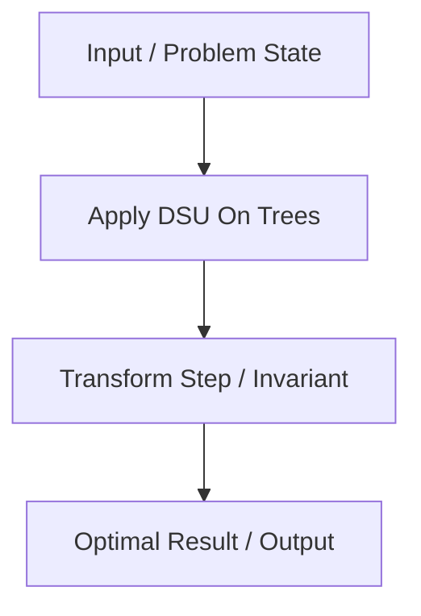

# DSU On Trees

> **Category:** Trees · **Tier:** Competitive Programming (Sack on Tree)

---

## 🔗 Resources & Visualizers
- **YouTube:** [Watch DSU On Trees Visual Guide](https://www.youtube.com/results?search_query=DSU%20On%20Trees%20algorithm%20visual%20explanation)
- **Blog / Editorial:** [CP-Algorithms / GeeksforGeeks Guide](https://www.google.com/search?q=DSU%20On%20Trees%20algorithm%20tutorial%20CP%20algorithms)
- **Interactive Visualizer:** [VisuAlgo Interactive Simulation](https://visualgo.net/en)

---

## 🧠 Intuition & Mental Model
> [!TIP]
> **Core Concept:** DSU on Trees is a tree algorithm used to efficiently

DSU on Trees is a tree algorithm used to efficiently
answer subtree queries by merging smaller subtree data into larger ones.
It optimizes repeated subtree computations using
the small-to-large merging technique.
How the Algorithm Works
Root the tree at node 1
For every node, you want to compute some information about its entire subtree
Each node maintains a data structure (usually frequency/count map)
While returning from DFS:
Always keep the largest child’s data
Merge all smaller children’s data into the largest one
This guarantees that each element moves only O(log N) times overall
Result: subtree queries handled efficiently without recomputation
Example Tree
1
├── 2
│   ├── 4
│   └── 5
└── 3
Colors
1 → 1
2 → 2
3 → 1
4 → 3
5 → 2

---

## 🎯 When to Use & Problem Triggers
- **Trigger 1:** When the brute-force enumeration takes quadratic time or higher and a linear/logarithmic invariant exists.
- **Trigger 2:** Common patterns involving **Trees**, subsegments, query sequences, or optimal substructures.
- **Trigger 3:** Constraints where $N \ge 10^5$ require $O(N)$ or $O(N \log N)$ performance.

---

## 📊 Visual Explanation & Dry Run



<details>
<summary>🔍 <strong>Step-by-Step Algorithm Walkthrough</strong> (Click to expand)</summary>

1. **Initialization:** Set up boundary pointers, state variables, or base auxiliary arrays.
2. **Iteration / Traversal:** Advance through the input elements while maintaining the algorithmic invariant.
3. **State Transition:** Update the current state, dynamic array, or accumulator in $O(1)$ or $O(\log N)$.
4. **Final Result:** Extract the optimal answer from the computed state or reconstructed solution.

</details>

---

## 💻 Algorithm Code (Java)

```java
import java.io.*;
import java.util.*;

class Main {

    static List<Integer>[] g;
    static int[] col;
    static Map<Integer, Integer>[] mp;
    static int[] ans;

    static void dfs(int u, int p) {
        mp[u] = new HashMap<>();
        mp[u].put(col[u], 1);

        for (int v : g[u]) {
            if (v == p) continue;

            dfs(v, u);

            if (mp[u].size() < mp[v].size()) {
                Map<Integer, Integer> t = mp[u];
                mp[u] = mp[v];
                mp[v] = t;
            }

            for (int c : mp[v].keySet()) {
                mp[u].put(c, mp[u].getOrDefault(c, 0) + mp[v].get(c));
            }
        }

        ans[u] = mp[u].size();
    }

    public static void main(String[] args) {
        int n = 5;

        g = new ArrayList[n + 1];
        col = new int[n + 1];
        mp = new HashMap[n + 1];
        ans = new int[n + 1];

        for (int i = 1; i <= n; i++) g[i] = new ArrayList<>();

        g[1].add(2);
        g[2].add(1);
        g[1].add(3);
        g[3].add(1);
        g[2].add(4);
        g[4].add(2);
        g[2].add(5);
        g[5].add(2);

        col[1] = 1;
        col[2] = 2;
        col[3] = 1;
        col[4] = 3;
        col[5] = 2;

        dfs(1, 0);

        for (int i = 1; i <= n; i++) {
            System.out.println("Node " + i + " -> " + ans[i]);
        }
    }
}
```

---

## ⏱️ Complexity Analysis
- **Time Complexity (TC):** Typically `O(N)` or `O(N log N)` depending on auxiliary sorting or tree operations.
- **Space Complexity (SC):** Typically `O(1)` auxiliary space or `O(N)` for auxiliary arrays/tables.

---

## 🔄 Similar & Connected Algorithms
- **Related Category:** Explore other fundamental algorithms in [Trees](../).
- **Composite Patterns:** Often combined with Prefix Sums, Binary Search on Answer, or Dynamic Programming memoization.

---

## ⚔️ Practice Questions

### 🟡 LeetCode
- [ ] [Explore DSU On Trees Problems on LeetCode](https://leetcode.com/problemset/?search=DSU%20On%20Trees%20LeetCode) — `Practice`

### 🔵 CodeChef & Codeforces
- [ ] [Practice on Codeforces Problemset](https://codeforces.com/problemset) — `Catalog`
- [ ] [Practice on CodeChef Practice Portal](https://www.codechef.com/practice) — `Catalog`
