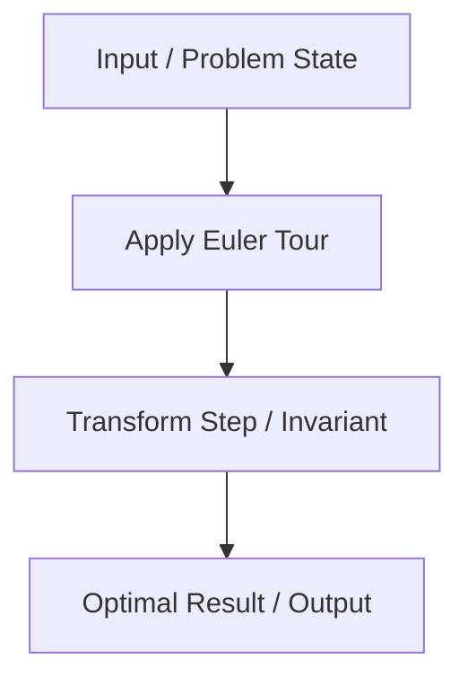

# Euler Tour

> **Category:** Trees · **Tier:** Advanced Interview (Subtree Queries)

---

## 🔗 Resources & Visualizers
- **YouTube:** [Watch Euler Tour Visual Guide](https://www.youtube.com/results?search_query=Euler%20Tour%20algorithm%20visual%20explanation)
- **Blog / Editorial:** [CP-Algorithms / GeeksforGeeks Guide](https://www.google.com/search?q=Euler%20Tour%20algorithm%20tutorial%20CP%20algorithms)
- **Interactive Visualizer:** [VisuAlgo Interactive Simulation](https://visualgo.net/en)

---

## 🧠 Intuition & Mental Model
> [!TIP]
> **Core Concept:** Euler Tour is a DFS-based technique where each

Euler Tour is a DFS-based technique where each
node in a tree is visited when entered and when exited,
producing a linear traversal.
It helps convert tree problems into array/range problems.
How the Algorithm Works
Start DFS from the root.
When a node is first visited → record entry time.
Traverse all its children recursively.
When returning back → record exit time.
Each node appears twice in the Euler tour (enter + exit).
The traversal is stored in an array (Euler array).

---

## 🎯 When to Use & Problem Triggers
- **Trigger 1:** When the brute-force enumeration takes quadratic time or higher and a linear/logarithmic invariant exists.
- **Trigger 2:** Common patterns involving **Trees**, subsegments, query sequences, or optimal substructures.
- **Trigger 3:** Constraints where $N \ge 10^5$ require $O(N)$ or $O(N \log N)$ performance.

---

## 📊 Visual Explanation & Dry Run



<details>
<summary>🔍 <strong>Step-by-Step Algorithm Walkthrough</strong> (Click to expand)</summary>

1. **Initialization:** Set up boundary pointers, state variables, or base auxiliary arrays.
2. **Iteration / Traversal:** Advance through the input elements while maintaining the algorithmic invariant.
3. **State Transition:** Update the current state, dynamic array, or accumulator in $O(1)$ or $O(\log N)$.
4. **Final Result:** Extract the optimal answer from the computed state or reconstructed solution.

</details>

---

## 💻 Algorithm Code (Java)

```java
import java.io.*;
import java.util.*;

class Main {

    static int t = 0;
    static int[] in, out, euler;
    static List<Integer>[] g;

    static void dfs(int u, int p) {
        in[u] = t;
        euler[t++] = u;

        for (int v : g[u]) {
            if (v == p) continue;
            dfs(v, u);
            euler[t++] = u;
        }

        out[u] = t - 1;
    }

    public static void main(String[] args) throws Exception {
        PrintWriter outw = new PrintWriter(System.out);

        int n = 3;

        g = new ArrayList[n + 1];
        for (int i = 1; i <= n; i++) g[i] = new ArrayList<>();

        g[1].add(2);
        g[2].add(1);
        g[1].add(3);
        g[3].add(1);

        in = new int[n + 1];
        out = new int[n + 1];
        euler = new int[2 * n];

        dfs(1, 0);

        outw.println("Euler Tour:");
        for (int i = 0; i < t; i++)
            outw.print(euler[i] + " ");

        outw.println("\nEntry Times:");
        for (int i = 1; i <= n; i++)
            outw.println(i + " -> " + in[i]);

        outw.println("Exit Times:");
        for (int i = 1; i <= n; i++)
            outw.println(i + " -> " + out[i]);

        outw.flush();
    }
}
```

---

## ⏱️ Complexity Analysis
- **Time Complexity (TC):** Typically `O(N)` or `O(N log N)` depending on auxiliary sorting or tree operations.
- **Space Complexity (SC):** Typically `O(1)` auxiliary space or `O(N)` for auxiliary arrays/tables.

---

## 🔄 Similar & Connected Algorithms
- **Related Category:** Explore other fundamental algorithms in [Trees](../).
- **Composite Patterns:** Often combined with Prefix Sums, Binary Search on Answer, or Dynamic Programming memoization.

---

## ⚔️ Practice Questions

### 🟡 LeetCode
- [ ] [Explore Euler Tour Problems on LeetCode](https://leetcode.com/problemset/?search=Euler%20Tour%20LeetCode) — `Practice`

### 🔵 CodeChef & Codeforces
- [ ] [Practice on Codeforces Problemset](https://codeforces.com/problemset) — `Catalog`
- [ ] [Practice on CodeChef Practice Portal](https://www.codechef.com/practice) — `Catalog`
