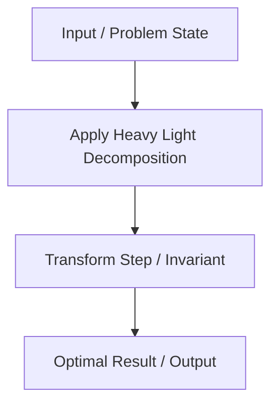

# Heavy Light Decomposition

> **Category:** Trees · **Tier:** Competitive Programming (Path Queries)

---

## 🔗 Resources & Visualizers
- **YouTube:** [Watch Heavy Light Decomposition Visual Guide](https://www.youtube.com/results?search_query=Heavy%20Light%20Decomposition%20algorithm%20visual%20explanation)
- **Blog / Editorial:** [CP-Algorithms / GeeksforGeeks Guide](https://www.google.com/search?q=Heavy%20Light%20Decomposition%20algorithm%20tutorial%20CP%20algorithms)
- **Interactive Visualizer:** [VisuAlgo Interactive Simulation](https://visualgo.net/en)

---

## 🧠 Intuition & Mental Model
> [!TIP]
> **Core Concept:** Heavy-Light Decomposition splits a tree into log-number of

Heavy-Light Decomposition splits a tree into log-number of
chains so that tree path queries can be reduced to array range queries.
It converts tree problems into segment-tree / Fenwick-tree problems.
Algorithm Explanation
Root the tree (usually at node 1)
Compute subtree sizes using DFS
For each node, choose the child with maximum subtree size as heavy child
Heavy edges form chains, light edges break chains
Each node gets:
head → chain leader
pos → position in linear array
Any path u → v becomes O(log N) chain jumps
Each chain segment is handled using range query structure
Example Tree
1
├── 2
│   ├── 4
│   └── 5
└── 3
Query: Path sum from node 4 to node 3

---

## 🎯 When to Use & Problem Triggers
- **Trigger 1:** When the brute-force enumeration takes quadratic time or higher and a linear/logarithmic invariant exists.
- **Trigger 2:** Common patterns involving **Trees**, subsegments, query sequences, or optimal substructures.
- **Trigger 3:** Constraints where $N \ge 10^5$ require $O(N)$ or $O(N \log N)$ performance.

---

## 📊 Visual Explanation & Dry Run



<details>
<summary>🔍 <strong>Step-by-Step Algorithm Walkthrough</strong> (Click to expand)</summary>

1. **Initialization:** Set up boundary pointers, state variables, or base auxiliary arrays.
2. **Iteration / Traversal:** Advance through the input elements while maintaining the algorithmic invariant.
3. **State Transition:** Update the current state, dynamic array, or accumulator in $O(1)$ or $O(\log N)$.
4. **Final Result:** Extract the optimal answer from the computed state or reconstructed solution.

</details>

---

## 💻 Algorithm Code (Java)

```java
import java.io.*;
import java.util.*;

class HLDExample {

    static int n = 5;
    static List<Integer>[] g = new ArrayList[n + 1];
    static int[] parent = new int[n + 1];
    static int[] depth = new int[n + 1];
    static int[] heavy = new int[n + 1];
    static int[] size = new int[n + 1];
    static int[] head = new int[n + 1];
    static int[] pos = new int[n + 1];
    static int curr = 1;
    static int[] val = {0, 1, 2, 3, 4, 5};
    static int[] base = new int[n + 1];

    public static void main(String[] args) {

        for (int i = 1; i <= n; i++) g[i] = new ArrayList<>();

        g[1].add(2);
        g[2].add(1);
        g[1].add(3);
        g[3].add(1);
        g[2].add(4);
        g[4].add(2);
        g[2].add(5);
        g[5].add(2);

        dfs(1, 0);

        decompose(1, 1);

        int u = 4, v = 3;
        int ans = query(u, v);
        System.out.println(ans);
    }

    static int dfs(int u, int p) {
        parent[u] = p;
        size[u] = 1;
        int mx = 0;

        for (int v : g[u]) {
            if (v == p) continue;

            depth[v] = depth[u] + 1;
            int sz = dfs(v, u);
            size[u] += sz;

            if (sz > mx) {
                mx = sz;
                heavy[u] = v;
            }
        }

        return size[u];
    }

    static void decompose(int u, int h) {
        head[u] = h;
        pos[u] = curr;
        base[curr++] = val[u];

        if (heavy[u] != 0)
            decompose(heavy[u], h);

        for (int v : g[u]) {
            if (v != parent[u] && v != heavy[u])
                decompose(v, v);
        }
    }

    static int query(int u, int v) {
        int res = 0;

        while (head[u] != head[v]) {
            if (depth[head[u]] < depth[head[v]]) {
                int t = u;
                u = v;
                v = t;
            }

            res += rangeSum(pos[head[u]], pos[u]);
            u = parent[head[u]];
        }

        if (depth[u] > depth[v]) {
            int t = u;
            u = v;
            v = t;
        }

        res += rangeSum(pos[u], pos[v]);
        return res;
    }

    static int rangeSum(int l, int r) {
        int s = 0;
        for (int i = l; i <= r; i++)
            s += base[i];
        return s;
    }
}
```

---

## ⏱️ Complexity Analysis
- **Time Complexity (TC):** Typically `O(N)` or `O(N log N)` depending on auxiliary sorting or tree operations.
- **Space Complexity (SC):** Typically `O(1)` auxiliary space or `O(N)` for auxiliary arrays/tables.

---

## 🔄 Similar & Connected Algorithms
- **Related Category:** Explore other fundamental algorithms in [Trees](../).
- **Composite Patterns:** Often combined with Prefix Sums, Binary Search on Answer, or Dynamic Programming memoization.

---

## ⚔️ Practice Questions

### 🟡 LeetCode
- [ ] [Explore Heavy Light Decomposition Problems on LeetCode](https://leetcode.com/problemset/?search=Heavy%20Light%20Decomposition%20LeetCode) — `Practice`

### 🔵 CodeChef & Codeforces
- [ ] [Practice on Codeforces Problemset](https://codeforces.com/problemset) — `Catalog`
- [ ] [Practice on CodeChef Practice Portal](https://www.codechef.com/practice) — `Catalog`
