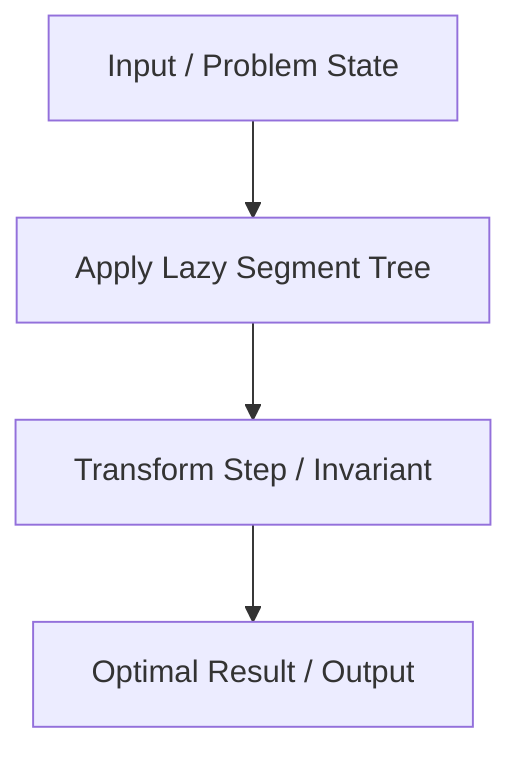

# Lazy Segment Tree

> **Category:** Trees · **Tier:** Advanced Interview (Range Updates)

---

## 🔗 Resources & Visualizers
- **YouTube:** [Watch Lazy Segment Tree Visual Guide](https://www.youtube.com/results?search_query=Lazy%20Segment%20Tree%20algorithm%20visual%20explanation)
- **Blog / Editorial:** [CP-Algorithms / GeeksforGeeks Guide](https://www.google.com/search?q=Lazy%20Segment%20Tree%20algorithm%20tutorial%20CP%20algorithms)
- **Interactive Visualizer:** [VisuAlgo Interactive Simulation](https://visualgo.net/en)

---

## 🧠 Intuition & Mental Model
> [!TIP]
> **Core Concept:** Lazy Propagation Segment Tree is an optimized segment

Lazy Propagation Segment Tree is an optimized segment
tree technique used to delay range updates
so that each update/query runs in logarithmic time instead of linear time.
How the algorithm works
Segment Tree stores information (like sum/min/max) for array ranges
Range updates (add value to a range) are expensive if done directly
Lazy array stores pending updates for a node
When a node fully overlaps the update range:
Update node value
Store update in lazy[node]
Actual propagation to children happens only when required
This avoids repeated updates → huge performance gain
Example:
Array = [1, 2, 3, 4, 5]
Operation: Add +10 to range [1,3]
Query: Sum of range [0,4]

---

## 🎯 When to Use & Problem Triggers
- **Trigger 1:** When the brute-force enumeration takes quadratic time or higher and a linear/logarithmic invariant exists.
- **Trigger 2:** Common patterns involving **Trees**, subsegments, query sequences, or optimal substructures.
- **Trigger 3:** Constraints where $N \ge 10^5$ require $O(N)$ or $O(N \log N)$ performance.

---

## 📊 Visual Explanation & Dry Run



<details>
<summary>🔍 <strong>Step-by-Step Algorithm Walkthrough</strong> (Click to expand)</summary>

1. **Initialization:** Set up boundary pointers, state variables, or base auxiliary arrays.
2. **Iteration / Traversal:** Advance through the input elements while maintaining the algorithmic invariant.
3. **State Transition:** Update the current state, dynamic array, or accumulator in $O(1)$ or $O(\log N)$.
4. **Final Result:** Extract the optimal answer from the computed state or reconstructed solution.

</details>

---

## 💻 Algorithm Code (Java)

```java
import java.io.*;
import java.util.*;


import java.io.*;
import java.util.*;

class LazyPropagationST {

    static int[] st;
    static int[] lazy;
    static int n;

    static void build(int node, int l, int r, int[] arr) {
        if (l == r) {
            st[node] = arr[l];
            return;
        }
        int mid = (l + r) >> 1;
        build(node << 1, l, mid, arr);
        build(node << 1 | 1, mid + 1, r, arr);
        st[node] = st[node << 1] + st[node << 1 | 1];
    }

    static void push(int node, int l, int r) {
        if (lazy[node] != 0) {
            st[node] += (r - l + 1) * lazy[node];
            if (l != r) {
                lazy[node << 1] += lazy[node];
                lazy[node << 1 | 1] += lazy[node];
            }
            lazy[node] = 0;
        }
    }

    static void update(int node, int l, int r, int ql, int qr, int val) {
        push(node, l, r);
        if (r < ql || l > qr) return;
        if (ql <= l && r <= qr) {
            lazy[node] += val;
            push(node, l, r);
            return;
        }
        int mid = (l + r) >> 1;
        update(node << 1, l, mid, ql, qr, val);
        update(node << 1 | 1, mid + 1, r, ql, qr, val);
        st[node] = st[node << 1] + st[node << 1 | 1];
    }

    static int query(int node, int l, int r, int ql, int qr) {
        push(node, l, r);
        if (r < ql || l > qr) return 0;
        if (ql <= l && r <= qr) return st[node];
        int mid = (l + r) >> 1;
        return query(node << 1, l, mid, ql, qr)
                + query(node << 1 | 1, mid + 1, r, ql, qr);
    }

    public static void main(String[] args) {
        int[] arr = {1, 2, 3, 4, 5};
        n = arr.length;
        st = new int[4 * n];
        lazy = new int[4 * n];
        build(1, 0, n - 1, arr);
        update(1, 0, n - 1, 1, 3, 10);
        System.out.println(query(1, 0, n - 1, 0, 4));
    }
}
```

---

## ⏱️ Complexity Analysis
- **Time Complexity (TC):** Typically `O(N)` or `O(N log N)` depending on auxiliary sorting or tree operations.
- **Space Complexity (SC):** Typically `O(1)` auxiliary space or `O(N)` for auxiliary arrays/tables.

---

## 🔄 Similar & Connected Algorithms
- **Related Category:** Explore other fundamental algorithms in [Trees](../).
- **Composite Patterns:** Often combined with Prefix Sums, Binary Search on Answer, or Dynamic Programming memoization.

---

## ⚔️ Practice Questions

### 🟡 LeetCode
- [ ] [Explore Lazy Segment Tree Problems on LeetCode](https://leetcode.com/problemset/?search=Lazy%20Segment%20Tree%20LeetCode) — `Practice`

### 🔵 CodeChef & Codeforces
- [ ] [Practice on Codeforces Problemset](https://codeforces.com/problemset) — `Catalog`
- [ ] [Practice on CodeChef Practice Portal](https://www.codechef.com/practice) — `Catalog`
