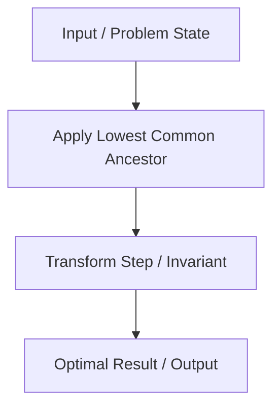

# Lowest Common Ancestor

> **Category:** Trees · **Tier:** Core Interview (High-Yield)

---

## 🔗 Resources & Visualizers
- **YouTube:** [Watch Lowest Common Ancestor Visual Guide](https://www.youtube.com/results?search_query=Lowest%20Common%20Ancestor%20algorithm%20visual%20explanation)
- **Blog / Editorial:** [CP-Algorithms / GeeksforGeeks Guide](https://www.google.com/search?q=Lowest%20Common%20Ancestor%20algorithm%20tutorial%20CP%20algorithms)
- **Interactive Visualizer:** [VisuAlgo Interactive Simulation](https://visualgo.net/en)

---

## 🧠 Intuition & Mental Model
> [!TIP]
> **Core Concept:** The Lowest Common Ancestor (LCA) of two nodes u and v in

The Lowest Common Ancestor (LCA) of two nodes u and v in
a tree is the deepest node that is an ancestor of both u and v.
Algorithm Explanation
Root the tree (usually at node 0 or 1)
Store parent and depth of every node using DFS
If depths differ, lift the deeper node up until both are at same depth
Move both nodes up together until they meet
The meeting node is the LCA

---

## 🎯 When to Use & Problem Triggers
- **Trigger 1:** When the brute-force enumeration takes quadratic time or higher and a linear/logarithmic invariant exists.
- **Trigger 2:** Common patterns involving **Trees**, subsegments, query sequences, or optimal substructures.
- **Trigger 3:** Constraints where $N \ge 10^5$ require $O(N)$ or $O(N \log N)$ performance.

---

## 📊 Visual Explanation & Dry Run



<details>
<summary>🔍 <strong>Step-by-Step Algorithm Walkthrough</strong> (Click to expand)</summary>

1. **Initialization:** Set up boundary pointers, state variables, or base auxiliary arrays.
2. **Iteration / Traversal:** Advance through the input elements while maintaining the algorithmic invariant.
3. **State Transition:** Update the current state, dynamic array, or accumulator in $O(1)$ or $O(\log N)$.
4. **Final Result:** Extract the optimal answer from the computed state or reconstructed solution.

</details>

---

## 💻 Algorithm Code (Java)

```java
import java.io.*;
import java.util.*;

class Main {

    static int N = 7;
    static int[] parent = new int[N];
    static int[] depth = new int[N];
    static List<Integer>[] g;

    static void dfs(int u, int p, int d) {
        parent[u] = p;
        depth[u] = d;
        for (int v : g[u]) {
            if (v != p) {
                dfs(v, u, d + 1);
            }
        }
    }

    static int lca(int u, int v) {
        while (depth[u] > depth[v]) {
            u = parent[u];
        }

        while (depth[v] > depth[u]) {
            v = parent[v];
        }

        while (u != v) {
            u = parent[u];
            v = parent[v];
        }

        return u;
    }

    public static void main(String[] args) {
        g = new ArrayList[N];
        for (int i = 0; i < N; i++) {
            g[i] = new ArrayList<>();
        }

        int[][] edges = {
                {0, 1}, {0, 2}, {1, 3}, {1, 4}, {2, 5}, {2, 6}
        };

        for (int[] e : edges) {
            g[e[0]].add(e[1]);
            g[e[1]].add(e[0]);
        }

        dfs(0, -1, 0);

        int u = 3, v = 4;
        System.out.println(lca(u, v));
    }
}
```

---

## ⏱️ Complexity Analysis
- **Time Complexity (TC):** Typically `O(N)` or `O(N log N)` depending on auxiliary sorting or tree operations.
- **Space Complexity (SC):** Typically `O(1)` auxiliary space or `O(N)` for auxiliary arrays/tables.

---

## 🔄 Similar & Connected Algorithms
- **Related Category:** Explore other fundamental algorithms in [Trees](../).
- **Composite Patterns:** Often combined with Prefix Sums, Binary Search on Answer, or Dynamic Programming memoization.

---

## ⚔️ Practice Questions

### 🟡 LeetCode
- [ ] [236. Lowest Common Ancestor of a Binary Tree](https://leetcode.com/problems/lowest-common-ancestor-of-a-binary-tree/) — `Medium`
- [ ] [235. Lowest Common Ancestor of a Binary Search Tree](https://leetcode.com/problems/lowest-common-ancestor-of-a-binary-search-tree/) — `Medium`

### 🔵 CodeChef & Codeforces
- [ ] [208E - Blood Cousins](https://codeforces.com/problemset/problem/208/E) — `2100`
