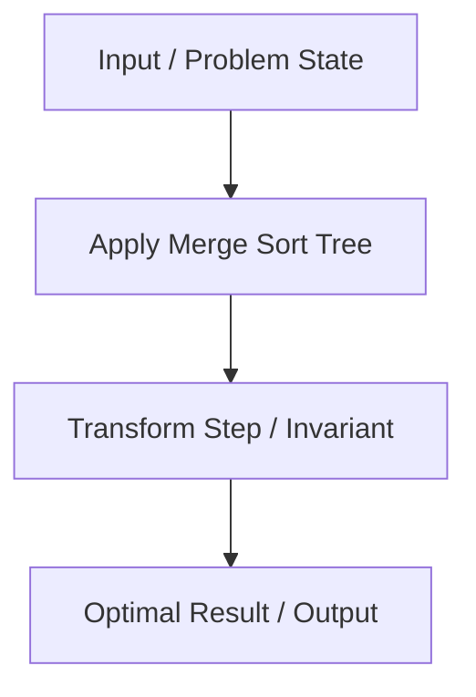

# Merge Sort Tree

> **Category:** Trees · **Tier:** Competitive Programming (Range Queries)

---

## 🔗 Resources & Visualizers
- **YouTube:** [Watch Merge Sort Tree Visual Guide](https://www.youtube.com/results?search_query=Merge%20Sort%20Tree%20algorithm%20visual%20explanation)
- **Blog / Editorial:** [CP-Algorithms / GeeksforGeeks Guide](https://www.google.com/search?q=Merge%20Sort%20Tree%20algorithm%20tutorial%20CP%20algorithms)
- **Interactive Visualizer:** [VisuAlgo Interactive Simulation](https://visualgo.net/en)

---

## 🧠 Intuition & Mental Model
> [!TIP]
> **Core Concept:** A Merge Sort Tree is a segment tree where each node stores

A Merge Sort Tree is a segment tree where each node stores
a sorted list of elements from its segment.
It enables fast range queries involving order statistics (e.g., count ≤ X in a range).
How the Algorithm Works
Split the array using segment tree logic.
Each node represents a segment [l, r].
Leaf node → stores one element (already sorted).
Internal node → merge sorted arrays of its left and right children.
For a query:
Visit only nodes fully inside the range.
Use binary search on node’s sorted list to answer queries like count ≤ X.

---

## 🎯 When to Use & Problem Triggers
- **Trigger 1:** When the brute-force enumeration takes quadratic time or higher and a linear/logarithmic invariant exists.
- **Trigger 2:** Common patterns involving **Trees**, subsegments, query sequences, or optimal substructures.
- **Trigger 3:** Constraints where $N \ge 10^5$ require $O(N)$ or $O(N \log N)$ performance.

---

## 📊 Visual Explanation & Dry Run



<details>
<summary>🔍 <strong>Step-by-Step Algorithm Walkthrough</strong> (Click to expand)</summary>

1. **Initialization:** Set up boundary pointers, state variables, or base auxiliary arrays.
2. **Iteration / Traversal:** Advance through the input elements while maintaining the algorithmic invariant.
3. **State Transition:** Update the current state, dynamic array, or accumulator in $O(1)$ or $O(\log N)$.
4. **Final Result:** Extract the optimal answer from the computed state or reconstructed solution.

</details>

---

## 💻 Algorithm Code (Java)

```java
import java.io.*;
import java.util.*;

class MergeSortTree {

    static int[] a;
    static int[][] t;

    static void build(int v, int l, int r) {
        if (l == r) {
            t[v] = new int[]{
                    a[l]
            };
            return;
        }

        int m = (l + r) >> 1;
        build(v << 1, l, m);
        build(v << 1 | 1, m + 1, r);

        int[] x = t[v << 1];
        int[] y = t[v << 1 | 1];
        t[v] = new int[x.length + y.length];

        int i = 0, j = 0, k = 0;
        while (i < x.length && j < y.length)
            t[v][k++] = (x[i] <= y[j]) ? x[i++] : y[j++];

        while (i < x.length) t[v][k++] = x[i++];
        while (j < y.length) t[v][k++] = y[j++];
    }

    static int query(int v, int l, int r, int ql, int qr, int x) {
        if (r < ql || l > qr) return 0;
        if (l >= ql && r <= qr) {
            return upperBound(t[v], x);
        }

        int m = (l + r) >> 1;
        return query(v << 1, l, m, ql, qr, x) +
                query(v << 1 | 1, m + 1, r, ql, qr, x);
    }

    static int upperBound(int[] arr, int x) {
        int l = 0, r = arr.length;
        while (l < r) {
            int m = (l + r) >> 1;
            if (arr[m] <= x) l = m + 1;
            else r = m;
        }

        return l;
    }

    public static void main(String[] args) {
        a = new int[]{1, 5, 2, 6, 3};
        int n = a.length;
        t = new int[4 * n][];

        build(1, 0, n - 1);

        int ans = query(1, 0, n - 1, 1, 3, 4);
        System.out.println(ans);
    }
}
```

---

## ⏱️ Complexity Analysis
- **Time Complexity (TC):** Typically `O(N)` or `O(N log N)` depending on auxiliary sorting or tree operations.
- **Space Complexity (SC):** Typically `O(1)` auxiliary space or `O(N)` for auxiliary arrays/tables.

---

## 🔄 Similar & Connected Algorithms
- **Related Category:** Explore other fundamental algorithms in [Trees](../).
- **Composite Patterns:** Often combined with Prefix Sums, Binary Search on Answer, or Dynamic Programming memoization.

---

## ⚔️ Practice Questions

### 🟡 LeetCode
- [ ] [Explore Merge Sort Tree Problems on LeetCode](https://leetcode.com/problemset/?search=Merge%20Sort%20Tree%20LeetCode) — `Practice`

### 🔵 CodeChef & Codeforces
- [ ] [Practice on Codeforces Problemset](https://codeforces.com/problemset) — `Catalog`
- [ ] [Practice on CodeChef Practice Portal](https://www.codechef.com/practice) — `Catalog`
