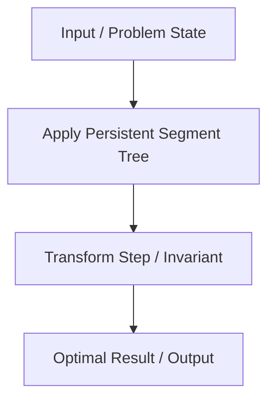

# Persistent Segment Tree

> **Category:** Trees · **Tier:** Competitive Programming (Versioned Trees)

---

## 🔗 Resources & Visualizers
- **YouTube:** [Watch Persistent Segment Tree Visual Guide](https://www.youtube.com/results?search_query=Persistent%20Segment%20Tree%20algorithm%20visual%20explanation)
- **Blog / Editorial:** [CP-Algorithms / GeeksforGeeks Guide](https://www.google.com/search?q=Persistent%20Segment%20Tree%20algorithm%20tutorial%20CP%20algorithms)
- **Interactive Visualizer:** [VisuAlgo Interactive Simulation](https://visualgo.net/en)

---

## 🧠 Intuition & Mental Model
> [!TIP]
> **Core Concept:** A Persistent Segment Tree is a segment tree where every update

A Persistent Segment Tree is a segment tree where every update
creates a new version, while old versions remain unchanged and accessible.
It achieves this by copying only the nodes on the update path.
How the Algorithm Works
Each node represents a range [l, r] and stores some aggregate (here: sum)
Initial build creates version 0
On update:
Only nodes along the update path are newly created
All untouched nodes are reused (shared)
Each update returns a new root, representing a new version
Queries can be done on any version independently
Example Used
Array = [1, 2, 3, 4]
Operation → Update index 1 to 10

---

## 🎯 When to Use & Problem Triggers
- **Trigger 1:** When the brute-force enumeration takes quadratic time or higher and a linear/logarithmic invariant exists.
- **Trigger 2:** Common patterns involving **Trees**, subsegments, query sequences, or optimal substructures.
- **Trigger 3:** Constraints where $N \ge 10^5$ require $O(N)$ or $O(N \log N)$ performance.

---

## 📊 Visual Explanation & Dry Run



<details>
<summary>🔍 <strong>Step-by-Step Algorithm Walkthrough</strong> (Click to expand)</summary>

1. **Initialization:** Set up boundary pointers, state variables, or base auxiliary arrays.
2. **Iteration / Traversal:** Advance through the input elements while maintaining the algorithmic invariant.
3. **State Transition:** Update the current state, dynamic array, or accumulator in $O(1)$ or $O(\log N)$.
4. **Final Result:** Extract the optimal answer from the computed state or reconstructed solution.

</details>

---

## 💻 Algorithm Code (Java)

```java
import java.io.*;
import java.util.*;

class PersistentSegmentTree {

    static class Node {
        int sum;
        Node left;
        Node right;

        Node(int s, Node l, Node r) {
            sum = s;
            left = l;
            right = r;
        }
    }

    static Node build(int l, int r, int[] a) {
        if (l == r) {
            return new Node(a[l], null, null);
        }

        int m = (l + r) >> 1;

        Node left = build(l, m, a);
        Node right = build(m + 1, r, a);

        return new Node(left.sum + right.sum, left, right);
    }

    static Node update(Node prev, int l, int r, int idx, int val) {
        if (l == r) {
            return new Node(val, null, null);
        }

        int m = (l + r) >> 1;

        if (idx <= m) {
            Node newLeft = update(prev.left, l, m, idx, val);
            return new Node(newLeft.sum + prev.right.sum, newLeft, prev.right);
        } else {
            Node newRight = update(prev.right, m + 1, r, idx, val);
            return new Node(prev.left.sum + newRight.sum, prev.left, newRight);
        }
    }

    static int query(Node node, int l, int r, int ql, int qr) {
        if (node == null || ql > r || qr < l) {
            return 0;
        }

        if (ql <= l && r <= qr) {
            return node.sum;
        }

        int m = (l + r) >> 1;

        return query(node.left, l, m, ql, qr) +
                query(node.right, m + 1, r, ql, qr);
    }

    public static void main(String[] args) {

        int[] a = {1, 2, 3, 4};

        Node version0 = build(0, 3, a);

        Node version1 = update(version0, 0, 3, 1, 10);

        System.out.println(query(version0, 0, 3, 0, 3));
        System.out.println(query(version1, 0, 3, 0, 3));
    }
}
```

---

## ⏱️ Complexity Analysis
- **Time Complexity (TC):** Typically `O(N)` or `O(N log N)` depending on auxiliary sorting or tree operations.
- **Space Complexity (SC):** Typically `O(1)` auxiliary space or `O(N)` for auxiliary arrays/tables.

---

## 🔄 Similar & Connected Algorithms
- **Related Category:** Explore other fundamental algorithms in [Trees](../).
- **Composite Patterns:** Often combined with Prefix Sums, Binary Search on Answer, or Dynamic Programming memoization.

---

## ⚔️ Practice Questions

### 🟡 LeetCode
- [ ] [Explore Persistent Segment Tree Problems on LeetCode](https://leetcode.com/problemset/?search=Persistent%20Segment%20Tree%20LeetCode) — `Practice`

### 🔵 CodeChef & Codeforces
- [ ] [Practice on Codeforces Problemset](https://codeforces.com/problemset) — `Catalog`
- [ ] [Practice on CodeChef Practice Portal](https://www.codechef.com/practice) — `Catalog`
