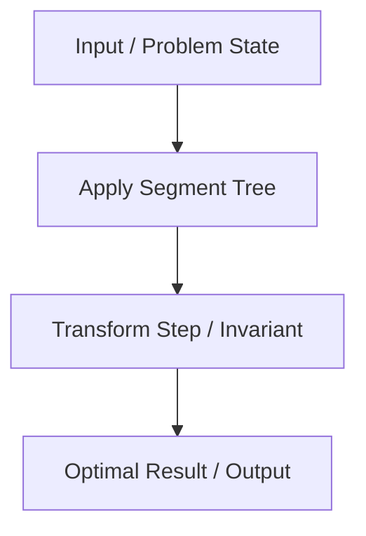

# Segment Tree

> **Category:** Trees · **Tier:** Advanced Interview (Range Queries)

---

## 🔗 Resources & Visualizers
- **YouTube:** [Watch Segment Tree Visual Guide](https://www.youtube.com/results?search_query=Segment%20Tree%20algorithm%20visual%20explanation)
- **Blog / Editorial:** [CP-Algorithms / GeeksforGeeks Guide](https://www.google.com/search?q=Segment%20Tree%20algorithm%20tutorial%20CP%20algorithms)
- **Interactive Visualizer:** [VisuAlgo Interactive Simulation](https://visualgo.net/en)

---

## 🧠 Intuition & Mental Model
> [!TIP]
> **Core Concept:** A Segment Tree is a binary tree used to efficiently

A Segment Tree is a binary tree used to efficiently
answer range queries (sum/min/max) on an array.
It supports both queries and updates in O(log n) time.
How the Algorithm Works
The array is recursively divided into segments
Each node stores information about a segment (e.g., sum of a range)
Root represents the entire array
Left child → left half, Right child → right half
Queries traverse only the relevant segments
Updates modify only affected nodes upward
Example Array: [1, 3, 5, 7, 9]
Operation: Range Sum Query

---

## 🎯 When to Use & Problem Triggers
- **Trigger 1:** When the brute-force enumeration takes quadratic time or higher and a linear/logarithmic invariant exists.
- **Trigger 2:** Common patterns involving **Trees**, subsegments, query sequences, or optimal substructures.
- **Trigger 3:** Constraints where $N \ge 10^5$ require $O(N)$ or $O(N \log N)$ performance.

---

## 📊 Visual Explanation & Dry Run



<details>
<summary>🔍 <strong>Step-by-Step Algorithm Walkthrough</strong> (Click to expand)</summary>

1. **Initialization:** Set up boundary pointers, state variables, or base auxiliary arrays.
2. **Iteration / Traversal:** Advance through the input elements while maintaining the algorithmic invariant.
3. **State Transition:** Update the current state, dynamic array, or accumulator in $O(1)$ or $O(\log N)$.
4. **Final Result:** Extract the optimal answer from the computed state or reconstructed solution.

</details>

---

## 💻 Algorithm Code (Java)

```java
import java.io.*;
import java.util.*;

class SegmentTree {

    static int[] st;
    static int n;

    public static void build(int[] a, int i, int l, int r) {
        if (l == r) {
            st[i] = a[l];
            return;
        }

        int m = (l + r) / 2;

        build(a, 2 * i, l, m);
        build(a, 2 * i + 1, m + 1, r);
        st[i] = st[2 * i] + st[2 * i + 1];
    }

    public static int query(int i, int l, int r, int ql, int qr) {
        if (qr < l || ql > r) {
            return 0;
        }

        if (ql <= l && r <= qr) {
            return st[i];
        }

        int m = (l + r) / 2;

        int leftSum = query(2 * i, l, m, ql, qr);
        int rightSum = query(2 * i + 1, m + 1, r, ql, qr);

        return leftSum + rightSum;
    }

    public static void main(String[] args) throws Exception {
        int[] a = {1, 3, 5, 7, 9};

        n = a.length;

        st = new int[4 * n];

        build(a, 1, 0, n - 1);

        int res = query(1, 0, n - 1, 1, 3);

        System.out.println(res);
    }
}
```

---

## ⏱️ Complexity Analysis
- **Time Complexity (TC):** Typically `O(N)` or `O(N log N)` depending on auxiliary sorting or tree operations.
- **Space Complexity (SC):** Typically `O(1)` auxiliary space or `O(N)` for auxiliary arrays/tables.

---

## 🔄 Similar & Connected Algorithms
- **Related Category:** Explore other fundamental algorithms in [Trees](../).
- **Composite Patterns:** Often combined with Prefix Sums, Binary Search on Answer, or Dynamic Programming memoization.

---

## ⚔️ Practice Questions

### 🟡 LeetCode
- [ ] [307. Range Sum Query - Mutable](https://leetcode.com/problems/range-sum-query-mutable/) — `Medium`
- [ ] [218. The Skyline Problem](https://leetcode.com/problems/the-skyline-problem/) — `Hard`

### 🔵 CodeChef & Codeforces
- [ ] [339D - Xenia and Bit Operations](https://codeforces.com/problemset/problem/339/D) — `1700`
