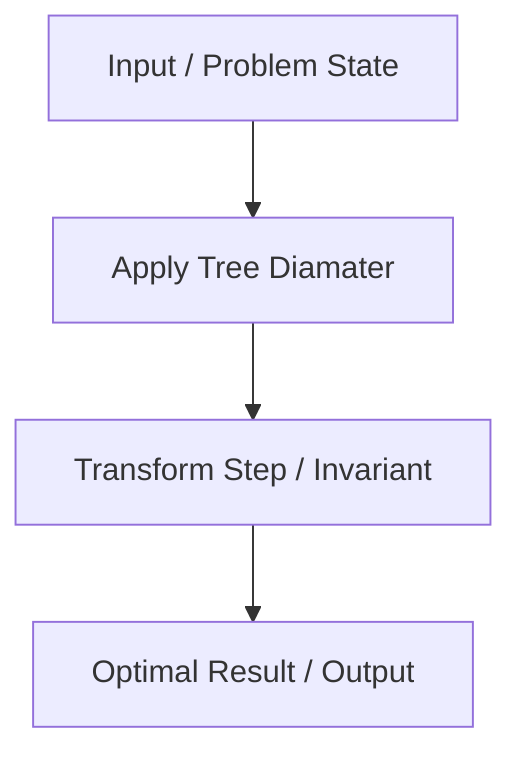

# Tree Diamater

> **Category:** Trees · **Tier:** Core Interview (High-Yield)

---

## 🔗 Resources & Visualizers
- **YouTube:** [Watch Tree Diamater Visual Guide](https://www.youtube.com/results?search_query=Tree%20Diamater%20algorithm%20visual%20explanation)
- **Blog / Editorial:** [CP-Algorithms / GeeksforGeeks Guide](https://www.google.com/search?q=Tree%20Diamater%20algorithm%20tutorial%20CP%20algorithms)
- **Interactive Visualizer:** [VisuAlgo Interactive Simulation](https://visualgo.net/en)

---

## 🧠 Intuition & Mental Model
> [!TIP]
> **Core Concept:** Tree Diameter is the longest distance (number of edges)

Tree Diameter is the longest distance (number of edges)
between any two nodes in a tree.
The path does not need to pass through the root.
Algorithm Explanation
Key Idea: Two DFS / BFS technique
Pick any node in the tree (say node 0)
Run DFS/BFS → find the farthest node from it (A)
From node A, run DFS/BFS again
The maximum distance found in second traversal is the tree diameter
Why it works
One end of the diameter is always the farthest node from any arbitrary node
Second traversal measures the full longest path

---

## 🎯 When to Use & Problem Triggers
- **Trigger 1:** When the brute-force enumeration takes quadratic time or higher and a linear/logarithmic invariant exists.
- **Trigger 2:** Common patterns involving **Trees**, subsegments, query sequences, or optimal substructures.
- **Trigger 3:** Constraints where $N \ge 10^5$ require $O(N)$ or $O(N \log N)$ performance.

---

## 📊 Visual Explanation & Dry Run



<details>
<summary>🔍 <strong>Step-by-Step Algorithm Walkthrough</strong> (Click to expand)</summary>

1. **Initialization:** Set up boundary pointers, state variables, or base auxiliary arrays.
2. **Iteration / Traversal:** Advance through the input elements while maintaining the algorithmic invariant.
3. **State Transition:** Update the current state, dynamic array, or accumulator in $O(1)$ or $O(\log N)$.
4. **Final Result:** Extract the optimal answer from the computed state or reconstructed solution.

</details>

---

## 💻 Algorithm Code (Java)

```java
import java.util.*;

class TreeDiameter {

    static List<Integer>[] g;
    static int farNode;
    static int maxDist;

    static void dfs(int u, int p, int d) {
        if (d > maxDist) {
            maxDist = d;
            farNode = u;
        }

        for (int v : g[u]) {
            if (v != p) {
                dfs(v, u, d + 1);
            }
        }
    }

    public static void main(String[] args) {
        int n = 4;

        g = new ArrayList[n];
        for (int i = 0; i < n; i++) g[i] = new ArrayList<>();

        g[0].add(1);
        g[1].add(0);
        g[0].add(2);
        g[2].add(0);
        g[2].add(3);
        g[3].add(2);

        maxDist = 0;
        dfs(0, -1, 0);

        int start = farNode;

        maxDist = 0;
        dfs(start, -1, 0);

        System.out.println("Tree Diameter = " + maxDist);
    }
}
```

---

## ⏱️ Complexity Analysis
- **Time Complexity (TC):** Typically `O(N)` or `O(N log N)` depending on auxiliary sorting or tree operations.
- **Space Complexity (SC):** Typically `O(1)` auxiliary space or `O(N)` for auxiliary arrays/tables.

---

## 🔄 Similar & Connected Algorithms
- **Related Category:** Explore other fundamental algorithms in [Trees](../).
- **Composite Patterns:** Often combined with Prefix Sums, Binary Search on Answer, or Dynamic Programming memoization.

---

## ⚔️ Practice Questions

### 🟡 LeetCode
- [ ] [Explore Tree Diamater Problems on LeetCode](https://leetcode.com/problemset/?search=Tree%20Diamater%20LeetCode) — `Practice`

### 🔵 CodeChef & Codeforces
- [ ] [Practice on Codeforces Problemset](https://codeforces.com/problemset) — `Catalog`
- [ ] [Practice on CodeChef Practice Portal](https://www.codechef.com/practice) — `Catalog`
