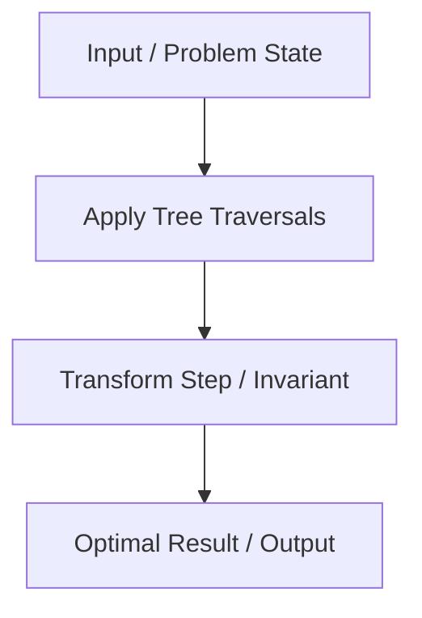

# Tree Traversals

> **Category:** Trees · **Tier:** Core Interview (Essential)

---

## 🔗 Resources & Visualizers
- **YouTube:** [Watch Tree Traversals Visual Guide](https://www.youtube.com/results?search_query=Tree%20Traversals%20algorithm%20visual%20explanation)
- **Blog / Editorial:** [CP-Algorithms / GeeksforGeeks Guide](https://www.google.com/search?q=Tree%20Traversals%20algorithm%20tutorial%20CP%20algorithms)
- **Interactive Visualizer:** [VisuAlgo Interactive Simulation](https://visualgo.net/en)

---

## 🧠 Intuition & Mental Model
> [!TIP]
> **Core Concept:** Morris Traversal is a binary tree traversal technique that

Morris Traversal is a binary tree traversal technique that
performs Inorder traversal without recursion and without
extra space by temporarily modifying tree links.
It achieves O(1) auxiliary space by reusing unused null right pointers.
Algorithm Explanation :
Start from the root node.
If the current node has no left child:
Visit the node.
Move to the right child.
If the current node has a left child:
Find its inorder predecessor (rightmost node in left subtree).
If predecessor’s right is null:
Create a temporary link to current node.
Move current to left child.
Else:
Remove the temporary link.
Visit the current node.
Move to right child.
Repeat until current becomes null.

---

## 🎯 When to Use & Problem Triggers
- **Trigger 1:** When the brute-force enumeration takes quadratic time or higher and a linear/logarithmic invariant exists.
- **Trigger 2:** Common patterns involving **Trees**, subsegments, query sequences, or optimal substructures.
- **Trigger 3:** Constraints where $N \ge 10^5$ require $O(N)$ or $O(N \log N)$ performance.

---

## 📊 Visual Explanation & Dry Run



<details>
<summary>🔍 <strong>Step-by-Step Algorithm Walkthrough</strong> (Click to expand)</summary>

1. **Initialization:** Set up boundary pointers, state variables, or base auxiliary arrays.
2. **Iteration / Traversal:** Advance through the input elements while maintaining the algorithmic invariant.
3. **State Transition:** Update the current state, dynamic array, or accumulator in $O(1)$ or $O(\log N)$.
4. **Final Result:** Extract the optimal answer from the computed state or reconstructed solution.

</details>

---

## 💻 Algorithm Code (Java)

```java
import java.io.*;

class Main {

    static class Node {
        int val;
        Node left, right;

        Node(int v) {
            val = v;
        }
    }

    static void morrisInorder(Node root) {
        Node curr = root;

        while (curr != null) {
            if (curr.left == null) {
                System.out.print(curr.val + " ");
                curr = curr.right;
            } else {
                Node pre = curr.left;

                while (pre.right != null && pre.right != curr) {
                    pre = pre.right;
                }

                if (pre.right == null) {
                    pre.right = curr;
                    curr = curr.left;
                } else {
                    pre.right = null;
                    System.out.print(curr.val + " ");
                    curr = curr.right;
                }
            }
        }
    }

    public static void main(String[] args) {
        Node root = new Node(1);
        root.left = new Node(2);
        root.right = new Node(3);

        morrisInorder(root);
    }
}
```

---

## ⏱️ Complexity Analysis
- **Time Complexity (TC):** Typically `O(N)` or `O(N log N)` depending on auxiliary sorting or tree operations.
- **Space Complexity (SC):** Typically `O(1)` auxiliary space or `O(N)` for auxiliary arrays/tables.

---

## 🔄 Similar & Connected Algorithms
- **Related Category:** Explore other fundamental algorithms in [Trees](../).
- **Composite Patterns:** Often combined with Prefix Sums, Binary Search on Answer, or Dynamic Programming memoization.

---

## ⚔️ Practice Questions

### 🟡 LeetCode
- [ ] [Explore Tree Traversals Problems on LeetCode](https://leetcode.com/problemset/?search=Tree%20Traversals%20LeetCode) — `Practice`

### 🔵 CodeChef & Codeforces
- [ ] [Practice on Codeforces Problemset](https://codeforces.com/problemset) — `Catalog`
- [ ] [Practice on CodeChef Practice Portal](https://www.codechef.com/practice) — `Catalog`
