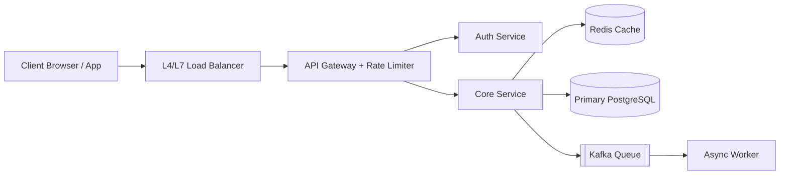

# System Design Building Blocks

Summarize key architecture concepts, trade-offs, and back-of-the-envelope numbers here.

## Core Topics
- **Load Balancing & API Gateway:** L4 vs L7, health checks, rate limiting algorithms (Token Bucket, Sliding Window).
- **Caching:** Cache-aside, write-through, write-back, eviction policies (LRU/LFU).
- **Databases & Scaling:** Read replicas, sharding/partitioning keys, consistent hashing, SQL vs NoSQL trade-offs.
- **Async Processing:** Message queues (Kafka/SQS), dead-letter queues, idempotency keys.

## Reference Architecture Diagram (Rendered via Kroki)

